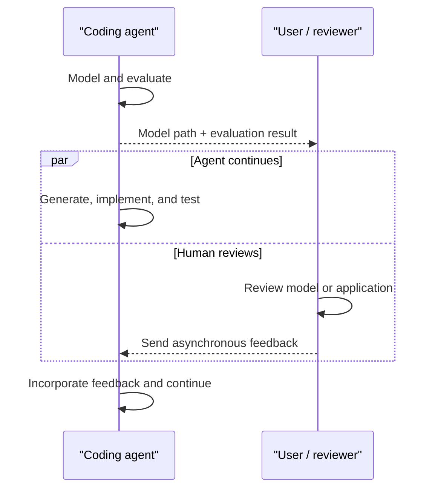

# TeaQL Agent Kit

> Already have a coding agent? Give it one prompt to start building with TeaQL.

<table>
  <tr>
    <td align="center"><a href="#start-with-a-prompt"><br>Claude Code</a></td>
    <td align="center"><a href="#start-with-a-prompt"><br>Codex</a></td>
    <td align="center"><a href="#start-with-a-prompt"><br>Cursor</a></td>
    <td align="center"><a href="#start-with-a-prompt"><br>GitHub Copilot</a></td>
    <td align="center"><a href="#start-with-a-prompt"><br>Gemini CLI</a></td>
    <td align="center"><a href="#start-with-a-prompt"><br>Pi</a></td>
  </tr>
  <tr>
    <td align="center"><a href="#start-with-a-prompt"><br>Qoder</a></td>
    <td align="center"><a href="#start-with-a-prompt"><br>DeepSeek Harness</a></td>
    <td align="center"><a href="#start-with-a-prompt"><br>ZCode</a></td>
    <td align="center"><a href="#start-with-a-prompt"><br>TRAE</a></td>
    <td align="center"><a href="#start-with-a-prompt"><br>OpenCode</a></td>
  </tr>
</table>

**Your coding agent + one prompt → start building with TeaQL.**
Use an agent mode that can read project files and run terminal commands.

Use the coding agent you already work with. TeaQL Agent Kit gives it a
model-first workflow to model your business, evaluate and repair the model,
generate an application, and verify the result. You do not need to learn the
runtime, generator, or toolchain architecture before trying it.

The kit combines a **TeaQL application Skill** with an independent **Agent Context
Kit**. See [governance engineering](#governance-engineering) for the control layers
and [agent feature activation](#agent-feature-activation) for what each adapter
actually enforces and how it is enabled.

## Start with a prompt

Open a project folder in your coding agent and paste this into its chat—not
your terminal:

```text
Follow the instructions from https://github.com/teaql/teaql-agent-kit

Build a small order-management application with customers, products, and
orders, using Rust and SQLite. Evaluate and repair the business model,
generate a runnable console application, and exercise Q queries and E
expressions in tests and a runtime smoke test. Report the actual results and
any remaining problems.

Finish with a short, evidence-backed development report in work-complete.md:
- Evaluate from a 2026-and-beyond, AI-assisted development perspective using
  the tools and model actually tested, not an assumption that humans must
  manually learn every modeling rule and generated API. Assess what the agent
  can learn from instructions and Assist, and what human effort remains.
  Judge runnable results, correctness, change effort, and operational costs;
  do not treat novelty or unfamiliar syntax alone as reasons to avoid trying
  the framework. Record demonstrated friction and risks, not generic warnings
  or assumptions that AI eliminates every learning cost.
- Show Q query and E expression examples from the application you actually
  ran, explaining how their typed APIs helped express the business logic.
- Inspect the evaluation, generation, build/test, and runtime logs. Cite
  relevant excerpts, including query purpose/comment and write audit context
  where present; report missing evidence and unresolved failures.
- Explain what work the model, generated library, runtime, and progressive
  Assist handled, and what application code and human decisions remained.
- Report actual token/context usage if available. Claim token savings only
  with a comparable measured baseline; otherwise mark savings not measured
  and explain the potential benefit of loading only relevant API guidance.
- Explain how model validation, consistent typed APIs, and regeneration may
  help larger projects. Separate observations from this run from expectations
  that this small example has not tested. Include costs and limitations.
```

The final report should help you judge what TeaQL contributed to your own
development task, with runnable code and log evidence you can inspect.

Replace the example requirement with your own. The agent needs access to the
repository instructions, permission to work in your project folder, and the
ability to run development commands.

**What to expect:** the agent may need to install or update TeaQL clients and
language build tools, download dependencies, and call TeaQL services for model
evaluation, generation, and API guidance. Network access is required for this
default workflow, and model content is sent to the configured service. Review
your agent's permission requests and your organization's data-sharing policy
before using private business requirements. One prompt starts the workflow;
it does not mean zero setup, no follow-up questions, or guaranteed success.

If you already have a local checkout, replace the first line with its path:

```text
Follow the instructions from ~/teaql-agent-kit
```

Use the actual checkout path on the machine where your agent runs. A local
checkout changes where instructions are read; it does not by itself make
evaluation and generation offline.

## What you get

See the benefits in a real application: the **Robot Task Board** showcase.

**Review less code to judge whether the business logic is correct.** Typed
queries and expressions keep business intent in a small, readable surface,
while the generated library and runtime handle shared mechanics. You still
review business rules and verify results; you do not have to reconstruct the
same query-building and data-access plumbing in every application method.

### Q API — compose queries you can review

Q describes what to load: filters, selected fields, related objects, ordering,
limits, and facets. Requests are composable: extract a child query or facet
into a named helper, then reuse it inside another query. Review each piece
and its composition instead of tracing scattered SQL construction and manual
result assembly. Typed field methods also let the compiler catch invalid API
calls before execution.

```rust
let task = Q::tasks()
    .with_id_is(id)
    .comment("Load task for status transition")
    .purpose("Move a task on the board")
    .execute_for_one(&ctx)
    .await?;
```

Adapted from the demo's [task service](https://github.com/teaql/robot-task-board/blob/main/rust-app-console/src/service.rs).

### E API — access business data with explicit safety

E provides typed paths through fields and related objects. It distinguishes
an absent value from data that was never loaded: optional values can have an
explicit fallback, while access to unloaded data produces a diagnostic rather
than silently treating it as missing. That reduces hand-written casts,
string-key lookups, and nested null checks. A reviewer can focus on the access
path, whether the query loaded it, and how absence is handled.

```rust
// Read the name from an already-loaded status object.
let name = E::task_status(status)
    .get_name()
    .eval()
    .unwrap_or(raw_str);
```

From the [showcase's E API example](https://teaql.io/blog/robot-task-board-showcase/),
where `raw_str` supplies the display fallback.

### Execution and audit trail

Follow a task transition through SQL, recorded changes, events, and the
refreshed board to debug behavior and investigate operations.

An excerpt from the demo's [recorded log](https://github.com/teaql/robot-task-board/blob/2560f9b73961eb1b26542d0ec91d5826b48421e5/actual-log.txt)
shows a task creation:

```text
[TIME]-[philip]-[DURATION]-[DEBUG]-SqlLogEntry - [Create task 'Review Mission Timeline'] - [1 rows affected]
          INSERT INTO task_data (id, name, version, status, platform) VALUES (1, 'Review Mission Timeline', 1, 1001, 1)
[TIME]-[philip]-[AUDIT]-Entity [Task] CREATED. [Create task 'Review Mission Timeline'] {id: U64(1),  name: Text("Review Mission Timeline"),  platform_id: U64(1),  status: U64(1001),  version: I64(1)}
```

The recorded file already normalizes timestamps and durations to `[TIME]`
and `[DURATION]`; these are not measured timings from a new run. The excerpt
ties the user identifier and declared intent to the SQL, affected-row count,
and created entity values—evidence you can inspect without tracing every
internal function call.

Developers supply intent and audit context; the runtime records execution and
changes through its configured logging and audit facilities. That makes the
trail useful for everyday debugging and observability, not just compliance.

**[Explore the source on GitHub](https://github.com/teaql/robot-task-board)**
 · **[Read the illustrated walkthrough](https://teaql.io/blog/robot-task-board-showcase/)**

The walkthrough documents the demo's API version. For a newly generated
application, use its current model-aware Assist for exact API calls.

## Less Context to Read, More Business Meaning

Context efficiency is a core harness-engineering goal: give the agent enough
information to understand and change the application without asking it to
read the framework's implementation.

| Mechanism | What the agent needs in context |
| --- | --- |
| **Short, information-dense workspace files** | Generated workspace guidance, the domain vocabulary, and focused application code explain the project's purpose and where work belongs. The generated domain library can be large; it is not the reading material for API discovery. |
| **Readable, semantically meaningful APIs** | Q queries, E paths, and mutation methods express business intent in application code. The agent works in the workspace rather than searching the underlying library to reconstruct that intent. |
| **Progressive model-aware Assist** | Load the relevant entity/action guidance first, then the specific field's operations when needed—not every method for every field. Missing guidance is reported, not replaced by speculative API calls or a library-wide source search. |
| **Explicit context lifetimes** | Keep stable principles, load task-specific guidance when needed, and stop carrying temporary material after its useful lifetime. Retain results and evidence references for later review. |

The independently publishable **[agent-context-kit](packages/agent-context-kit/)**
now lives in this repository and implements explicit context-lifecycle controls
through host adapters: ephemeral
content is visible for one model response, while named instruction blocks stay
active until a trusted workflow discards them. It changes the context sent to
the model without deleting the original transcript. These controls require a
supporting adapter; a README instruction alone cannot evict context from an
arbitrary coding agent.

### Prompt lifetimes: consume once or keep until discarded

**Consume once (“burn after reading”)** — mark temporary guidance or a large
tool result for one response:

```markdown
<!--ephemeral-->
Task-specific API guidance needed for the next implementation step.
```

The marker applies to the entire containing message or tool result. After the
assistant responds, the adapter replaces that content with a small tombstone
in subsequent model requests. The original remains in the transcript for
inspection; “burn” does not mean secure erasure.

**Named block** — keep a phase's instructions active across requests:

```markdown
<!--BLOCK_ID:phase_modeling-->
Evaluate and repair the business model before generating application code.
<!--/BLOCK_ID:phase_modeling-->
```

Once that phase is complete, a trusted workflow explicitly discards it:

```markdown
<!--DISCARD_BLOCK:phase_modeling-->
```

The block is then absent from the next model request. Blocks come from trusted
context sources; ordinary tool output cannot revoke instructions. This lets
the harness retain the rules needed now without carrying every earlier phase's
instructions forever. See the [lifecycle protocol](packages/agent-context-kit/docs/protocol-v1.md)
and [Pi adapter](packages/agent-context-kit/docs/pi-adapter.md)
for enforcement and integration details.

### Tested with local models on NVIDIA DGX Spark

The [DGX Spark benchmark project](https://github.com/teaql/nvidia-dgx-spark-model-benchmark)
records modeling and repair experiments on that platform. One
[30-object moving-company run](https://github.com/teaql/nvidia-dgx-spark-model-benchmark/blob/main/reports/moving-company-30-pipeline.md)
used a fresh, bounded repair request after deterministic validation found
problems. Its final model had zero official evaluation errors, with warnings
and suggestions retained in the report. This is modeling evidence, not proof
of complete application correctness or a measured token-saving percentage for
the full harness or context-lifecycle adapter.

The practical aim is **less irrelevant context, less stale guidance, and a
smaller body of business code to review**. Measure context/token usage and
completion quality together; smaller prompts alone do not establish success.

## Governance engineering

The engineering goal is to give the agent a small, usable interface and enforce
its boundaries in tools and runtimes. Instructions describe the workflow;
deterministic checks decide what may execute and what may enter model context.

| Control layer | Mechanism | Evidence and boundary |
| --- | --- | --- |
| **Domain contract** | Save complete KSML, evaluate and repair, generate only at zero errors | Generation Service reports validate model semantics. Skill phase comments alone do not enforce transitions. |
| **Business operations** | Progressive Assist, typed Q/E APIs, query purpose/comment, write audit reason | Compile, test and runtime evidence from the resulting application; exact APIs come from current Assist. |
| **Agent file access** | `.agent-no-read.md`, checked reads/search/list, independent write roots and read-only paths | Pi and OpenCode controlled entry points reject access before returning source; generated directories are pruned before search traversal. |
| **Context lifetime** | Consume-once messages, named blocks and trusted discard | Supporting adapters build request-local views; original transcripts remain intact. Ordinary tool output cannot discard trusted instructions. |
| **Failure and recovery** | Bounded diagnostics, explicit policy denial, repeated-scope feedback and durable marker maintenance | Pi returns `isError: true`, `blocked: true`, `retryable: false`; repeated denials remain blocked and direct the agent to permitted alternatives. |

### Keep generated implementation out of context

Place an English `.agent-no-read.md` inside a generated directory:

```text
project/
  models/                          # readable KSML
  rust-app-console/
    AGENTS.md                      # readable application guide
    src/                           # readable/editable business code
    lib/
      .agent-no-read.md             # excludes this directory and descendants
  context-markers.json              # durable maintenance plan, outside outputs
```

```markdown
# Generated Code

This directory contains generated implementation files.
Use TeaQL Assist to discover APIs and edit application source outside this directory.
Do not retry excluded files with different paths, line ranges or tools.
Update the KSML model and regenerate through the authorized workflow.
```

The file's **existence** activates exclusion in a marker-aware adapter. Its body is
bounded, untrusted project guidance, not authority to bypass policy. Rebuilding an
output directory can delete its marker; the [maintenance CLI](packages/agent-context-kit/docs/context-marker-maintenance.md)
restores and checks markers from an explicit host-approved manifest.

Read exclusion and write permission are independent. The shared
[file policy](packages/agent-context-kit/docs/file-policy.md) defaults to no writes
and supports explicit `writeRoots` and `readOnlyPaths`. A `.agent-no-write.md`
write-marker protocol is not implemented. The native Pi bootstrap permits checked
application writes/edits and rejects writes into excluded directories; its current
tools require existing parent directories. The OpenCode strict plugin uses explicit
host-approved write roots. Neither is an operating-system sandbox.

### Make policy denials actionable

A successful policy check can still deny access. Pi's protected entry points
expose that denial as a tool error with machine-readable feedback:

```json
{
  "status": "excluded",
  "blocked": true,
  "retryable": false,
  "code": "CONTEXT_ACCESS_DENIED"
}
```

Repeated attempts share a canonical directory counter across files, aliases and
tools. Pi shortens repeated feedback and supplies a bounded host-policy reminder
before later requests. It does not stop unrelated permitted work or cache an old
denial as permanent authority: every access checks the current policy. A broad
search with skipped subtrees still returns permitted results normally. These
signals reduce ambiguity; they do not guarantee that every model stops retrying.

## Agent feature activation

**Repository snapshot: 2026-10-24.** These are capabilities implemented in this
package, not a claim that every host has been installed or tested live. A plugin
installation activates only its selected entry point. **ReadGuard** means configured
path/tool blocking; **marker policy** additionally controls directory traversal and
checked automatic context. The two are not interchangeable.

| Agent / entry point | Context lifetime controls | Read boundary | Controlled writes | Activation and evidence |
| --- | --- | --- | --- | --- |
| **Pi native CLI bootstrap** | Inline lifecycle handler; explicit trusted phase-source integration remains separate | Marker policy, fresh checked project context, non-retryable denial feedback | Checked native `write` / `edit` | Host wires the bootstrap behind ordinary `pi`; native CLI tests and Linux deployment smoke checks passed |
| **Pi dedicated SDK harness** | No lifecycle adapter composed by default | Marker policy, fresh checked project context, non-retryable denial feedback | Disabled | `createContextPolicyPiSession`; real Pi 1.4.0 with local deterministic provider tests |
| **Pi ordinary lifecycle plugin** | Named blocks, trusted discard, consume-once messages | Optional configured ReadGuard | No write-policy integration | `pi install <child-package-path>`; installing alone does not activate marker enforcement |
| **OpenCode V2 strict plugin** | Optional trusted `lifecycleFile`; request-local text-message lifetimes | Marker policy, checked project context and controlled tool catalog | Explicit write roots; create/overwrite/edit/delete/move | Opt-in `createOpenCodeContextPolicyPlugin`; pinned SDK 2.1.4 type and real Promise/Effect bridge tests; no application-server deployment claimed |
| **OpenCode ordinary V2 / V1 adapter** | Named blocks, trusted discard, consume-once adapter | Optional configured ReadGuard | No write-policy integration | Local plugin entry; V1 package-object entry requires 1.18.29+; separate from strict V2 |
| **Cline SDK / CLI / Kanban** | Named blocks, trusted discard, consume-once adapter | Optional configured ReadGuard | No write-policy integration | Cline plugin registration; adapter tests, no IDE-extension claim |
| **Kilo Code** | Named blocks, trusted discard, consume-once adapter | Optional configured ReadGuard | No write-policy integration | Server plugin; experimental host transforms, adapter tests |
| **MiMo Code** | Named blocks, trusted discard, consume-once adapter | Optional configured ReadGuard | No write-policy integration | Project plugin; experimental source-verified hooks, adapter tests |
| **DeepSeek Harness** | Named blocks, trusted discard, durable ephemeral projections | No read guard wired in this adapter | No write-policy integration | Harness overlay; lifecycle adapter tests |
| **Gemini CLI** | Named blocks, trusted discard, text-only consume-once | No read guard wired in this extension | No write-policy integration | `BeforeModel` extension; non-text tool payloads outside its stable view |
| **Hermes Agent** | Active blocks and trusted session discard; no consume-once rewriting | Configured ReadGuard | No write-policy integration | Native Python plugin; Python adapter tests |
| **Kimi Code / Qwen Code / Kiro CLI** | Current-request and delegated context; no consume-once rewriting | Configured ReadGuard | No write-policy integration | Host command hooks; contract tests; no full marker-aware harness |
| **GitHub Copilot CLI** | No lifecycle rewriting | Configured ReadGuard | No write-policy integration | `PreToolUse` hooks; command-hook tests |
| **Crush** | No lifecycle rewriting | Top-level configured ReadGuard | No write-policy integration | Command hook; subagent tool calls are outside its interception |
| **Codex / Claude Code / Cursor** | Protocol guidance Skill only in this package | No runtime enforcement claimed | No write-policy integration | Installable guidance; packaging does not imply enforcement |
| **Other coding agents shown above** | TeaQL Skill instructions where supported | No Context Kit enforcement claimed | No write-policy integration | The ability to read a Skill is separate from a runtime adapter |

### Activate the protected Pi entry point

The [native CLI bootstrap](packages/agent-context-kit/docs/pi-cli-policy.md) runs
Pi 1.4.0's native UI with controlled file tools. When the host has wired it into
the normal launcher, start a fresh session with `cd <project>; pi`; a separate
`pi-context` command is not required. Existing running sessions keep their old code
until restarted. Merely installing the ordinary lifecycle extension is insufficient.

Protected Pi/OpenCode modes disable arbitrary Shell, unguarded MCP/delegation and
automatic external resource loading. Pi can load explicitly approved capability
modules from its protected agent directory. The optional
[TeaQL Rust integration](integrations/pi-teaql/README.md) supplies evaluation,
progressive Assist, zero-error-gated library regeneration and fixed build/test
targets. This is project-specific host configuration, not an unrestricted terminal
or a complete seven-language workflow integration.

### Activate OpenCode V2 strict mode

Create a host-owned `.opencode/plugins/agent-context-policy.ts` in an isolated
OpenCode V2 profile, replacing the checkout and project paths:

```ts
import { createOpenCodeContextPolicyPlugin } from "/absolute/teaql-agent-kit/packages/agent-context-kit/src/adapters/opencode-context.ts";

export default createOpenCodeContextPolicyPlugin({
  projectRoot: "/absolute/project",
  writeRoots: ["models", "app/src", "app/tests"],
  readOnlyPaths: ["generated"],
  contextPaths: ["docs/api.md"],
  // Optional, explicitly trusted lifecycle declarations:
  lifecycleFile: ".agent-context-kit.md",
});
```

Use a fresh session and create markers in the generated directories. Do not load
the ordinary lifecycle plugin alongside this strict plugin. Strict mode requires
V2 and rejects V1. See the [OpenCode policy guide](packages/agent-context-kit/docs/opencode-context-policy.md)
for attachment handling, trusted-host assumptions and automatic-context limits.
OpenCode's strict plugin has SDK-level verification; an installed OpenCode server
and real-model end-to-end run remain to be verified.

See the full [compatibility guide](packages/agent-context-kit/docs/compatibility.md)
and [host installation guide](packages/agent-context-kit/docs/installation.md).

### Reproduce the engineering checks

```sh
npm ci
npm run check
npm pack --workspace @teaql/agent-context-kit
```

The root check covers TypeScript, Node unit/integration tests, Skill grammar and
installation contracts, and Python workspace/Hermes tests. The current verified
run passed **137 tests**: 105 package unit tests, 19 integration tests, 6 root
contracts and 7 Python tests. Pi's provider checks use a deterministic local
provider; the OpenCode SDK bridge uses a host-registry fixture. These are not paid
model quality benchmarks, full TeaQL workflow proofs or measured token savings.

## Repository layout and optional runtime

The normal `build-teaql-app` Skill remains at `skills/build-teaql-app/`.
Its installation and prompt-first workflow do not require the Node workspace.

`packages/agent-context-kit/` contains the independent context runtime, host
adapters, marker-maintenance skill and CLI. It retains the package name
`@teaql/agent-context-kit`, its public entry points, and its Apache-2.0 license;
the repository root remains MIT. Node.js 22.19+, the pinned Pi 1.4.0 SDK and
OpenCode 2.1.4 plugin SDK support runtime development and verification; these are
not requirements imposed on every TeaQL Skill user.

See [context runtime development and installation](docs/context-runtime.md)
for workspace checks, package builds and the current integration boundary. See
[host installation after migration](packages/agent-context-kit/docs/installation.md)
for local package paths, tarball installs and the Codex/Claude marketplaces. Moving the package here does not automatically add TeaQL
evaluate/generate/Assist or business-source editing tools to its dedicated harness.

## How it works

*A model-mediated harness for reliable agentic software development.*

TeaQL Agent Kit demonstrates a new harness pattern for coding agents. Instead
of letting an agent move directly from requirements to implementation, it
places an executable domain model between intent and code.

The model becomes an inspectable intermediate representation. A deterministic
evaluation service checks it and provides repair guidance. Generation turns
the validated model into a typed API boundary, while model-aware assist teaches
the agent the exact API available for the current domain.

The goal is not deterministic AI. It is deterministic structure around
non-deterministic AI.

**Correct-by-process, governed-by-runtime.** TeaQL governs both how software is
produced and how it behaves when it runs.

## Two Layers of Reliability

TeaQL applies constraints at two different times.

### Do Things Right: Development-time Process

The Agent Kit controls how a coding agent moves from requirement to working
software: model first, evaluate and repair, generate a typed contract, request
current model-aware assist, implement within that contract, and verify the
result with evidence.

### Do the Right Thing: Runtime Governance

The TeaQL runtime controls how the resulting application acts: operations
carry identity and intent, reads declare purpose and comment, writes declare
an audit reason, external capabilities are explicitly granted, and typed
entity graphs constrain mutation.

Runtime governance does not choose the correct business policy. It makes
application actions contextual, bounded, observable, and auditable once that
policy has been chosen.

## What This Repository Introduces

Most coding agents operate in a prompt-to-code loop:

```text
requirement → agent → code → test → repair
```

TeaQL inserts a model-mediated control layer:

```text
requirement
    ↓
inspectable domain model
    ↓
deterministic evaluation and repair
    ↓
generated typed contract
    ↓
constrained agent implementation
    ↓
compile, test, runtime, and audit evidence
```

This changes the role of the agent. The agent no longer invents the domain
contract, persistence surface, and business logic at the same time. It models
intent first, works against a generated contract, and demonstrates completion
with concrete evidence.

TeaQL Agent Kit is therefore not merely a code-generation Skill. It is a
reference implementation of a model-mediated harness for coding agents.

## How TeaQL Supports Reliable Agent Delivery

Start with a business requirement in natural language. The agent turns it
into a model, evaluates it, and repairs it using concrete feedback. Once the
model has no evaluation errors, generate a domain library backed by the
chosen language's TeaQL runtime and scaffold a runnable workspace. Deep
customization then happens in that workspace, using the library and runtime
as its foundation.

| Stage | What the agent does | What TeaQL provides | What you can review |
| --- | --- | --- | --- |
| **Modeling and evaluation** | Translate requirements into business objects, fields, and relationships; evaluate, repair, and re-evaluate. | Modeling instructions and examples; deterministic evaluation with errors, warnings, suggestions, and repair guidance. | The saved business model and evaluation findings, before substantial application code is written. |
| **Generation — library + runtime** | Generate the domain library for the selected language, connect it to the corresponding TeaQL runtime, and scaffold the workspace. | Model-specific typed Q/E and mutation APIs backed by a reusable, domain-independent runtime for execution, validation, query tracing, and audited saves. | Generation results, the selected runtime version, and the scaffold's build and startup results. |
| **Deep customization — workspace** | Implement business rules, workflows, integrations, and UI in workspace-owned code using the library and runtime; compile, test, and refine the application. | Workspace instructions and progressive **model-aware Assist** for entity/action and field-specific API guidance, with runtime feedback during execution. | Focused business code, test results, and execution/audit logs that show what the application actually did. |

The runtime is an existing library for the chosen language, not newly
generated application code. The domain library is generated from your model;
the workspace is where application-specific customization belongs.

Assist remains available throughout customization: the agent asks for the
operation it needs instead of guessing methods or loading the entire
generated library into its context. If implementation reveals a model defect,
return to evaluation, repair the model, and regenerate its library.

Delivery is demonstrated through build results, tests, a runtime smoke test,
and an evidence-backed completion report—not just the agent saying "done."
You still decide whether the modeled rules meet the business need. TeaQL's
goal is to make that judgment possible by reviewing a small amount of
business-focused code and concrete evidence.

## Where the Harness Lives

The repository publishes the harness as a focused Agent Skill:

- [`SKILL.md`](skills/build-teaql-app/SKILL.md) defines the mandatory
  model-first execution order and agent constraints.
- [`golden-example.xml`](skills/build-teaql-app/references/golden-example.xml)
  provides a compact grammar example without loading a full rule catalog.
- [`toolchains.md`](skills/build-teaql-app/references/toolchains.md) binds the
  workflow to versioned clients, evaluation, generation, and model-aware
  assist.
- [`work-complete.md`](skills/build-teaql-app/references/work-complete.md)
  defines the evidence required before the agent reports completion.

Together, these artifacts coordinate the agent, the model evaluator, generated
contracts, runtime policies, verification tools, and parallel human review.

## Select Runtime Source Explicitly

Generated manifests always declare published TeaQL dependencies. They never
contain a maintainer's local filesystem paths. A consumer workspace selects
the source independently with `teaql-workspace.yaml`:

- `runtimeSource: workspace` resolves the seven runtime repositories, records
  their exact commits and dirty state, and is used while changing a runtime;
- `runtimeSource: release` requires package versions and rejects path
  overrides, and is used for published-package regression.

Start from
[`teaql-workspace.workspace.yaml`](examples/teaql-workspace.workspace.yaml) or
[`teaql-workspace.release.yaml`](examples/teaql-workspace.release.yaml). These
files use JSON-compatible YAML so the verifier has no third-party dependency.

```bash
./tools/teaql_workspace.py apply \
  --config teaql-workspace.yaml \
  --workspace /path/to/generated-application

./tools/teaql_workspace.py verify --config teaql-workspace.yaml
```

`apply` writes `.teaql/runtime-source-evidence.json` in the application
workspace. Native package-manager overrides remain workspace-owned: Maven
reactor/local repository, Cargo patch, Go workspace/replace, npm workspace,
Swift package edit, .NET project reference, or Python editable install. The
Harness verifies the selected repositories before those native commands run;
the generator neither creates nor guesses these overrides.

## Explore the Live Harness

The live Generation Service presents the same model-mediated path as a guided,
five-stage walkthrough:

[Walk through the live TeaQL harness](https://api.teaql.io/latest/)

1. Turn a business requirement into a saved KSML domain contract.
2. Inspect the model as an interactive entity graph or data dictionary.
3. Evaluate the model, repair reported Errors, and retain the report as
   evidence.
4. Generate stable domain libraries and separate editable application
   workspaces and libraries for Java, Rust, Go, Swift, Python, C#/.NET, or TypeScript.
5. Develop against the generated contract with model-, language-, action-, and
   object-specific assist.

The page also exposes a live evaluation report, generation target catalog,
workspace API guides, and language-specific previews and assist for create,
update, query, list, expression, delete, debugging, granted tool API, and
runtime customization guidance. Preview depth can vary by language; the
current target catalog and generated assist are authoritative.

This live surface demonstrates that the evaluator, generators, typed
contracts, and just-in-time assist are concrete parts of the harness rather
than conventions described only in a prompt. The `/latest/` endpoint follows
the current published demo and may evolve with the service.

## Install the Agent Skill

Install the complete model-to-application workflow with the community Skills
CLI:

```bash
npx skills add teaql/teaql-agent-kit --skill build-teaql-app
```

Then ask your coding agent:

```text
Use $build-teaql-app to first draft and save a complete KSML model, then
evaluate and repair it before generating a runnable TeaQL application: ...
```

This repository can publish multiple focused Skills. `build-teaql-app` is the
end-to-end workflow: model, evaluate, generate, implement, verify, and report.

## From Business Intent to Typed Contract

A compact KSML model describes business objects, fields, constants,
relationships, modules, and storage:

```xml
<root cfg_mask_china_mobile="false"
      data_service="sqlite"
      name="bookstore-service"
      org="example"
      _module_key="root">
  <bookstore _name="Bookstore"
             _module="Organization"
             _module_key="organization"
             name="TeaQL Books"/>
  <book _name="Book"
        _module="Catalog"
        _module_key="catalog"
        title="Domain Modeling with TeaQL"
        bookstore="bookstore()"/>
</root>
```

The Generation Service turns the validated model into entities, relation
metadata, typed queries, null-safe expressions, graph persistence, checker and
behavior hooks, repository registration, documentation, and a runnable
application workspace.

Application code then reads in domain language rather than generic ORM
plumbing:

```rust
let merchants = Q::merchants()
    .select_name()
    .which_names_contain("tea")
    .purpose("Find merchants for search results")
    .comment("Search merchant names")
    .execute_for_list(&ctx)
    .await?;
```

The generated domain library is a model-derived contract and remains
regenerable. Business logic stays in a separate editable application workspace.

## Continuous Agent Work, Parallel Human Review

After modeling and evaluation, the agent sends a compact signal:

```text
Model Ready
- Model: /path/to/project/models/model.xml
- Evaluation: passed — 0 errors, 2 warnings, 1 suggestion
```

The path lets a person open and review the actual model. The notification does
not stop execution: the agent continues generating, implementing, testing, and
repairing the application.

Human review happens alongside that work. A reviewer can inspect the model or
running application at any time and send feedback asynchronously. If feedback
changes the domain contract, the agent updates the model, evaluates it again,
regenerates, and continues.



Review is a parallel activity, not a waiting node.

## Runtime Safeguards

TeaQL constrains how agents interact with business data:

1. **Mandatory identity** — operations pass through `UserContext`, making
   identity and request scope explicit.
2. **Intent auditing** — reads declare their purpose and comment; writes carry
   an audit description.
3. **Capability sandbox** — HTTP, file access, messaging, and similar tools are
   explicitly granted rather than ambient.
4. **Graph mutability control** — typed entity graphs replace manually
   coordinated SQL updates and relationship loops.
5. **Semantic error translation** — infrastructure failures can become stable,
   actionable application errors.

## Runnable Examples and Harness Evidence

The Agent Kit defines the shared harness pattern. Runnable applications remain
in language-specific repositories so their toolchains, dependencies, and
release cycles can evolve independently:

- [TeaQL Java App Examples](https://github.com/teaql/teaql-java-app-examples)
- [TeaQL Rust App Examples](https://github.com/teaql/teaql-rust-app-examples)

| Example | Application surface | Harness behavior demonstrated |
| --- | --- | --- |
| [Java Robot Task Board](https://github.com/teaql/teaql-java-app-examples/tree/main/001-robot-task-board-android) | Local Android application | Model-derived typed CRUD, query purpose and comment, audited writes, and visible SQL execution logs |
| [Java Vending Machine Desktop](https://github.com/teaql/teaql-java-app-examples/tree/main/002-vending-machine-compose-desktop) | Compose Desktop and SQLite | A generated domain library embedded in a local desktop application |
| [Java World Cup CLI](https://github.com/teaql/teaql-java-app-examples/tree/main/003-world-cpu-2006-cli) | Interactive CLI and SQLite | Declarative domain modeling, generated query and entity APIs, relational queries, and audited persistence |
| [Java Vending Machine](https://github.com/teaql/teaql-java-app-examples/tree/main/005-vending-machine-web-spring-boot) | Spring Boot, [Quarkus](https://github.com/teaql/teaql-java-app-examples/tree/main/006-vending-machine-web-quarkus), and [Micronaut](https://github.com/teaql/teaql-java-app-examples/tree/main/007-vending-machine-web-micronaut) | One modeled domain hosted across multiple Java application frameworks |
| [Rust World Cup CLI](https://github.com/teaql/teaql-rust-app-examples/tree/main/001-world-cpu-2006-cli) and [TUI](https://github.com/teaql/teaql-rust-app-examples/tree/main/002-world-cup-2006-tui) | Interactive CLI, TUI, and SQLite | Model-to-generated-library separation, typed `Q` and `E` APIs, and audited graph persistence |
| [Rust Linux System Info](https://github.com/teaql/teaql-rust-app-examples/tree/main/003-linux-sysinfo-using-teaql) | Linux `/proc` provider and console UI | A generated typed query boundary applied to an operating-system capability rather than a conventional database |

These examples provide runnable application and code evidence. An end-to-end
recording can complement them with agent-execution evidence: the initial model,
evaluation and repair rounds, generated assist, policy checks, compilation,
tests, and runtime results.


## Cross-Language Feature Matrix

TeaQL natively supports seven major languages. While the core philosophy remains identical, the implementation maturity of specific features varies by ecosystem.

**Legend:**
- 🟢 **Supported:** Feature is implemented and working.
- 🟡 **Partial / WIP:** Feature is partially implemented or under active development.
- ⚪ **Not Supported:** Feature is not yet implemented or not applicable for this language tier.

### Verified Runtime Snapshot — 2026-08-12

This snapshot records generated-code and real-runtime evidence, not only the
presence of an adapter or a code template. A green database entry means the
generated API chain compiled and ran against that database with real
persistence. Some results are on validated development branches, so merge and
release availability can lag behind this engineering snapshot.

| Language runtime | Latest verified runtime evidence | Verified databases | Qualification |
| :--- | :--- | :--- | :--- |
| [Java](https://github.com/teaql/teaql-java) | Full database matrix: `9 tests / 0 failures / 0 errors / 0 skipped` | PostgreSQL, MySQL, SQLite, Oracle, DB2, DM8, SAP HANA, SQL Server, DuckDB | Broadest enterprise database coverage; Android remains SQLite-only |
| [Rust](https://github.com/teaql/teaql-rs) | Generated API chain and runtime suite passed; runtime branch coverage reached 95.5% | PostgreSQL, MySQL, SQLite | SQL Server is intentionally out of scope |
| [Go](https://github.com/teaql/teaql-golang) | Runtime suite and generated SQL matrix passed; statement coverage reached 94.9% | PostgreSQL, MySQL, SQLite | Includes generated-query `WithComment` compatibility |
| [Swift](https://github.com/teaql/teaql-swift) | Generated Swift package and runtime suite pass on the current conformance baseline | SQLite | Local-first runtime for iOS/macOS plus a TFP federation client; no federation server |
| [Python](https://github.com/teaql/teaql-python) | `73` runtime tests passed plus generated real-SQL integration | PostgreSQL, MySQL, SQLite | Uses real async SQL providers; no longer counted as JSON/fake persistence |
| [C# / .NET](https://github.com/teaql/teaql-dotnet) | `124` runtime tests passed plus generated database integration | PostgreSQL, MySQL, SQLite, SQL Server | SQL Server support is specific to Java and .NET |
| [TypeScript](https://github.com/teaql/teaql-ts) | `6` runtime tests plus `4 tests / 0 failures / 0 errors / 0 skipped` generated matrix | PostgreSQL, MySQL, SQLite | Canonical Node SQL runtime; the browser/TFP entry installs and loads no database driver |

| Feature Area | Java | Rust | Go | Swift | Python | C# (.NET) | TypeScript |
| :--- | :---: | :---: | :---: | :---: | :---: | :---: | :---: |
| **Core Runtime** | | | | | | | |
| AST Parsing & Query Execution | 🟢 | 🟢 | 🟢 | 🟢 | 🟢 | 🟢 | 🟢 |
| Audited Graph Persistence | 🟢 | 🟢 | 🟢 | 🟢 | 🟢 | 🟢 | 🟢 |
| UserContext & Identity | 🟢 | 🟢 | 🟢 | 🟢 | 🟢 | 🟢 | 🟢 |
| Triple-Intent Policy | 🟢 | 🟢 | 🟢 | 🟢 | 🟢 | 🟢 | 🟢 |
| **Data Providers** | | | | | | | |
| SQLite | 🟢 | 🟢 | 🟢 | 🟢 | 🟢 | 🟢 | 🟢 |
| MySQL | 🟢 | 🟢 | 🟢 | ⚪ | 🟢 | 🟢 | 🟢 |
| PostgreSQL | 🟢 | 🟢 | 🟢 | ⚪ | 🟢 | 🟢 | 🟢 |
| MS SQL Server | 🟢 | ⚪ | ⚪ | ⚪ | ⚪ | 🟢 | ⚪ |
| Oracle | 🟢 | ⚪ | ⚪ | ⚪ | ⚪ | ⚪ | ⚪ |
| DB2 | 🟢 | ⚪ | ⚪ | ⚪ | ⚪ | ⚪ | ⚪ |
| SAP HANA | 🟢 | ⚪ | ⚪ | ⚪ | ⚪ | ⚪ | ⚪ |
| DuckDB | 🟢 | ⚪ | ⚪ | ⚪ | ⚪ | ⚪ | ⚪ |
| DM8 (Dameng) | 🟢 | ⚪ | ⚪ | ⚪ | ⚪ | ⚪ | ⚪ |
| Snowflake | 🟡 | ⚪ | ⚪ | ⚪ | ⚪ | ⚪ | ⚪ |
| **Advanced Integrations** | | | | | | | |
| Federation Protocol (TFP) Server | 🟢 | 🟢 | 🟢 | ⚪ | ⚪ | 🟢 | ⚪ |
| TFP HTTP Provider (Client) | ⚪ | ⚪ | ⚪ | 🟢 | 🟢 | ⚪ | 🟢 |
| Web Framework Integration | 🟢 | 🟢 | 🟢 | ⚪ | 🟢 | 🟢 | ⚪ |
| Redis Cache | 🟢 | 🟢 | 🟢 | ⚪ | 🟢 | 🟢 | ⚪ |
| **Cloud Native (Microservices)** | | | | | | | |
| Nacos Integration | 🟢 | 🟢 | 🟢 | ⚪ | ⚪ | ⚪ | ⚪ |
| Consul Integration | 🟢 | 🟢 | 🟢 | ⚪ | ⚪ | ⚪ | ⚪ |
| Health Actuator & Metrics | 🟢 | 🟢 | 🟢 | ⚪ | ⚪ | ⚪ | ⚪ |
| **Tooling & Code Generation** | | | | | | | |
| Typed DSL Generation | 🟢 | 🟢 | 🟢 | 🟢 | 🟢 | 🟢 | 🟢 |
| Dynamic String Interpreter | 🟢 | ⚪ | ⚪ | ⚪ | ⚪ | ⚪ | 🟢 |

> **💡 Note on Java Database Support:**
> The Java ecosystem has highly adaptable data provider support depending on its execution environment:
> - **Server / Backend (Spring Boot, Quarkus, etc.):** The latest full-chain matrix verifies **PostgreSQL, MySQL, SQLite, Oracle, DB2, DM8, SAP HANA, SQL Server, and DuckDB**. Snowflake is not counted as verified because no official locally runnable Snowflake database service image was found.
> - **Android / Mobile (`teaql-android`):** When running natively on mobile, database support is strictly constrained to **SQLite** to ensure local compatibility, zero-configuration, and memory efficiency without pulling in heavy JDBC drivers.

> **💡 Note on TypeScript Profiles:**
> The green SQL entries apply to the explicit Node.js profiles
> `teaql-ts/sql/postgres`, `teaql-ts/sql/mysql`, and
> `teaql-ts/sql/sqlite`. The default `teaql-ts` browser/TFP entry has no SQL
> import and does not install or load `pg`, `mysql2`, or `better-sqlite3`.

## TeaQL Generation Service

The Generation Service provides the most complete model-derived output set:

- Java, Rust, Go, Swift, Python, C#/.NET, and TypeScript typed domain libraries
- Editable application workspaces
- Model evaluation and repair guidance
- Progressive query assist: request `language-assist-query/entity` for the
  executable base query and field index, then
  `language-assist-query/entity.field` for exact select/filter/order/group/
  facet/aggregate methods. Assist locations always use canonical KSML names.
- Object-specific create, update, delete, and expression assist

Kotlin/JVM application code is supported through the generated Java library
and TeaQL Java runtime, as demonstrated by the
[Compose Desktop vending-machine example](https://github.com/teaql/teaql-java-app-examples/tree/main/002-vending-machine-compose-desktop).
It is application-language interoperability, not a separate eighth runtime or
generation target.

Swift is a current `swift-lib-core` generation target with a local-first SQLite
runtime for iOS and macOS and a TFP client. It does not currently provide a
Swift TFP server or a separate editable application-workspace target. C++,
Dart, Ruby, and other unlisted smaller language ecosystems are not currently
supported.
- Runtime and tool guides generated for the current domain
- Data-design, model-view, and frontend model outputs

### Open-source Rust generation

Developers who want to inspect or extend an open-source generation service
written in Rust can explore
[teaql-forge-rs](https://github.com/teaql/teaql-forge-rs). Forge is a small open
implementation and does not claim full feature parity with the TeaQL Generation
Service.

## Explore the Kit

- [Build TeaQL App Skill](skills/build-teaql-app/SKILL.md)
- [TeaQL Java runtime](https://github.com/teaql/teaql-java)
- [TeaQL Rust runtime](https://github.com/teaql/teaql-rs)
- [Open-source Rust generator](https://github.com/teaql/teaql-forge-rs)
- [TeaQL](https://teaql.io)

## License

The TeaQL Skill and repository-root material use the [MIT License](LICENSE).
The independently publishable `packages/agent-context-kit/` package retains its
[Apache-2.0 License](packages/agent-context-kit/LICENSE); bundled assets retain
their accompanying licenses.
